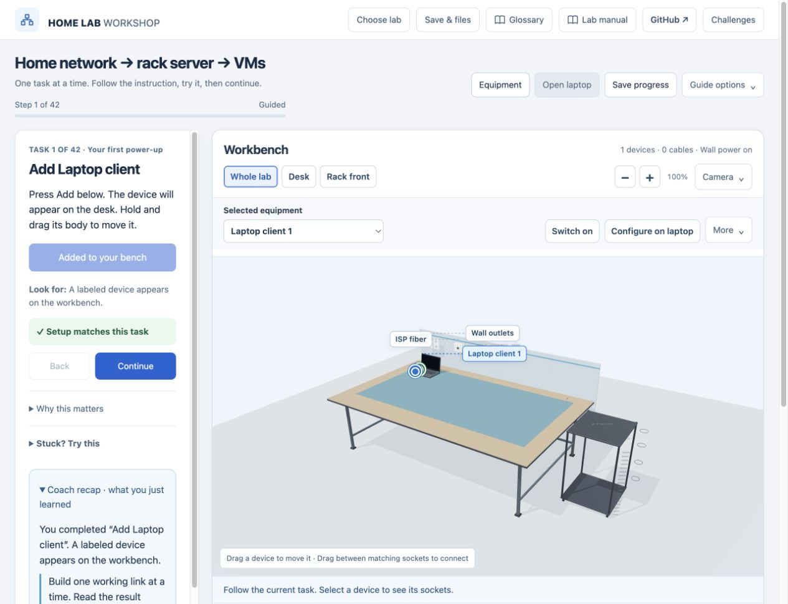

# Home Lab Workshop · Virtual IT Lab Portfolio

A collection of browser-based labs for learning networking, operating systems, scripting and troubleshooting. Build a network in a 3D workshop, practice commands inside simulated computers, and follow packets through a network with an interactive coach.

**[Open the portfolio](https://hotfarino.github.io/home-lab-workshop/)** · [Report an issue](https://github.com/Hotfarino/home-lab-workshop/issues) · [Build and deployment](https://github.com/Hotfarino/home-lab-workshop/actions/workflows/pages.yml)

[](https://github.com/Hotfarino/home-lab-workshop/actions/workflows/pages.yml)



## Choose a lab

| Experience | What you practice | Open |
| --- | --- | --- |
| **Home Lab Workshop** | Cabling, power, rack equipment, IPv4, DHCP, DNS, Wi-Fi, RAID, VMs and fault diagnosis | [Networking lab](https://hotfarino.github.io/home-lab-workshop/home-lab.html) |
| **Orbit OS & Scripting Lab** | Windows/PowerShell, Ubuntu/Bash, macOS/zsh, files, processes, Python and virtual machines | [OS and scripting](https://hotfarino.github.io/home-lab-workshop/orbit/) |
| **Packet Rescue** | Bit Builder, Subnet Slicer, Packet Delivery and Network Repair with Orbit coaching | [Play Packet Rescue](https://hotfarino.github.io/home-lab-workshop/orbit/#packet-rescue) |
| **Packet Blocks** | Eight chapters, 32 rounds, 24 aligned rescues, shared OS network settings and Orbit coaching | [Play Packet Blocks](https://hotfarino.github.io/home-lab-workshop/orbit/#packet-blocks) |
| **RAID workflow guide** | Striping, mirroring, parity, disk failure and rebuilds | [Explore RAID](https://hotfarino.github.io/home-lab-workshop/raid-workflow.html) |

The networking lab has **8 paths**, including free build, and 6 independent challenges. Orbit has **15 learning paths with 93 tasks**. Packet Rescue has **24 missions across 4 sectors**. Counts describe curriculum organization, not unique skills: network paths share foundation tasks. [Networking lab details](NETWORK-LAB.md) · [Orbit lab details](orbit/README.md)

### A five-minute tour

1. Open **Home Lab Workshop**, choose **Start learning**, and follow the current task beside the bench. Add a laptop, connect equipment and open the laptop to configure it.
2. Return with **All labs** and open **Orbit**. Keep Guided mode, open a workstation and follow Orbit's instruction in Terminal or Code.
3. Open **Packet Rescue → Packet Delivery** to see local versus routed traffic. Try **Network Repair** to diagnose a wrong IP address, subnet mask or gateway.

A desktop or laptop browser with WebGL 2 gives the best 3D experience. The portfolio works on smaller screens; the OS lessons also expose computer buttons when 3D is unavailable. No account or API key is required.

## Engineering highlights

- **Interactive 3D:** Three.js scenes, Blender-authored GLB hardware, draggable parts, compatible cable endpoints, rack placement and animated connection feedback.
- **Model-driven learning:** hardware/network state drives task validation, troubleshooting results and coaching. Independent challenges give requirement-by-requirement feedback.
- **OS teaching interfaces:** simulated desktops, file managers, process tools, command interpreters, VM controls and code editors.
- **Real browser Python:** a pinned, self-hosted Pyodide runtime executes Python in a Web Worker, with stop/time-limit handling. The simulated shell does not execute commands on the visitor's computer.
- **Accessible learning controls:** keyboard-accessible device actions, adjustable guidance, optional browser narration, reduced-motion support and searchable references.
- **Delivery:** one repository, one static build and one GitHub Pages deployment. CI runs both applications' tests before publishing an allowlisted runtime artifact.

## Run locally

Use Node.js 24+, npm and Python 3:

```sh
git clone https://github.com/Hotfarino/home-lab-workshop.git
cd home-lab-workshop
npm ci --ignore-scripts
npm test
npm run build
npm run serve
```

Open **http://127.0.0.1:8783/**. `dist/` contains the complete website. Serve over HTTP; opening HTML directly from disk will not load modules and workers correctly.

No backend service, paid hosting or environment secrets are needed. The prebuilt Three.js and Python runtime assets are included. Python's first start downloads the bundled runtime from this site's own origin.

## Repository map

```text
index.html                 Portfolio entry point
portfolio/                 Landing page styles, icon and real app previews
home-lab.html              Networking lab entry point (existing URL preserved)
lab-*.js / lab-*.css       Networking engine, coaching, UI and 3D scene
blender/                   Editable network hardware and room sources
raid-workflow.html         Interactive storage guide
orbit/                     OS/scripting app, games, assets, sources and tests
scripts/build-pages.mjs    Combined static build and local-reference validation
.github/workflows/         Automated checks and GitHub Pages deployment
```

Networking checks run with `npm run test:network`; Orbit checks run with `npm run test:orbit`. DOM tests stub WebGL and do not replace visual browser checks. The build validates relative links/imports for GitHub's `/home-lab-workshop/` project path. Tests, snapshots, editable Blender sources, personal progress exports, npm dependencies and Git metadata are excluded from the published website.

## Walkthrough verification

The October 21, 2026 release audit combined browser walkthroughs with automated checks. Browser coverage included all 93 Orbit tasks, 24 Packet Rescue missions, 32 guided Packet Blocks rounds, the seven networking course completion paths (reusing validated foundations where offered), six independent network challenges, and the RAID guide's read/write, parity, rebuild, capacity, flashcard and quiz activities. Free Build was checked separately without its optional orientation checklist.

The audit corrected hidden cloud controls inside the laptop, script output leaking visually between lesson contexts, Free Build starting with a checklist, and misleading driver/cloud coaching. Wrong VM resources, bad DNS, wrong passwords and failed packet routes were tested as negative cases. Network export/import restored a completed build.

[Walkthrough observations](audits/public-walkthrough.json) record the tested actions; they are not a claim of exhaustive coverage. Automated checks cover 30 networking suites and 57 Orbit tests, including all 253 network task occurrences with shared foundations. Browser checks used Chromium in the in-app browser; narrow layouts were inspected at 390 and 768 pixels alongside desktop views. Audio controls were exercised, but speaker output and every browser/device combination were not independently verified. OS interfaces, packets and hardware remain teaching simulations.

## Scope and privacy

This is an independent educational project covering selected CompTIA A+ foundations, with deeper scripting and subnet practice. It is not official CompTIA training or a copy of CertMaster. Reference links and simulation limits appear inside the labs.

Operating systems, shell commands, devices, VMs and network packets are teaching simulations. **Python code actually runs in the browser worker.** No real cloud VM, OS kernel or external network traffic is created by the lab model. Technical simplifications are documented in each lab's manual and sources panel.

Progress stays in the current browser. Hosting addresses have separate browser storage: existing localhost saves do not automatically appear on GitHub Pages. Where the app offers export/import, use it to move your work. The collection contains the virtual lab projects, not the broader study repository or its question banks.

## Portfolio description

> Developed and iteratively tested a browser-based virtual IT lab portfolio using JavaScript, Three.js and Blender assets, combining guided networking simulations, OS and scripting practice, a browser Python runtime, and interactive troubleshooting games. Automated checks and GitHub Actions validate the apps before GitHub Pages deployment.

Use this description only to represent work and technical decisions you can explain in an interview. Be ready to discuss the network model, task checks, browser storage, simulation boundaries and how testing informed improvements.

## Credits and feedback

Preserve [network artwork credits](lab-os-artwork-credits.txt), the [Three.js license](three-license.txt), [Orbit asset provenance](orbit/ASSETS.md), and bundled Ubuntu/Yaru/Pyodide notices. Product names and artwork belong to their respective owners; no affiliation or endorsement is implied.

[Report an issue](https://github.com/Hotfarino/home-lab-workshop/issues) with the lab name, mission/task, browser, steps to reproduce and expected versus actual behavior. Screenshots help. Review exported files before attaching them.

## Packet Blocks campaign update

[Launch Packet Blocks](https://hotfarino.github.io/home-lab-workshop/orbit/#packet-blocks) for an untimed eight-chapter progression from four-bit training through DHCP/DNS and subnet troubleshooting. The original arcade and Rescue games remain in Mission map, preserving their saves. [Curriculum, sources and limitations](orbit/README.md#packet-blocks-campaign).

The campaign update passed 30 networking suites and 67 Orbit tests. Its additional stress tests cover 10,000 generated puzzles, 5,000 save/restore cycles and 300 UI lifecycle cycles. Browser smoke testing played representative early, middle and late missions; tested 100 bit toggles, 30 OS switches, reload, optional commands, reduced motion and layouts at 390/768/1280 pixels. [Detailed test record](audits/packet-blocks.json). These checks do not constitute exhaustive cross-browser or physical-touch-device certification. The earlier walkthrough above refers to the preserved original games.
